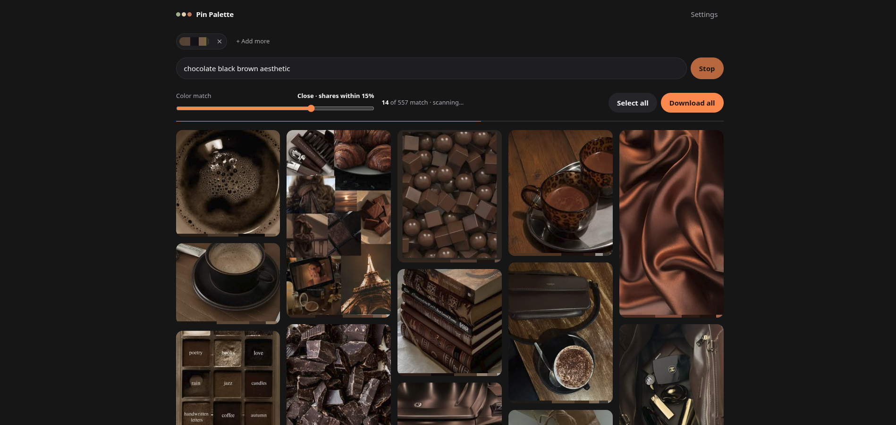

# Pin Palette

[](https://github.com/IamOumarIbrahim/pin-palette/actions/workflows/tests.yml)


[](LICENSE)

**Find and download Pinterest images that match your color palette.** Drop in a photo, a moodboard or a whole folder. Pin Palette extracts its color palette, searches Pinterest, and shows only the pins with the same colors in the same proportions. Pick the ones you like and download them in full resolution.

Useful for moodboards, brand and interior color schemes, outfit inspiration, wallpaper hunting and aesthetic collections.



## Features

- **Palette extraction** from one image or a folder (up to 8 colors, with how much of the image each one covers)
- **Editable palette**: drag to change color amounts, change or remove colors, add your own, or start from scratch with no image
- **Match strictness slider**, plus fine-tune controls for color tolerance, amount tolerance and number of colors
- **Live filtering**: results re-sort instantly as you move a slider or edit the palette
- **Bulk download** of full-size originals
- **One-line install** on Windows, macOS and Linux; runs locally in your browser, no account needed
- Optional Pinterest login for more results

## Install

**Windows**: open PowerShell and run:

```powershell
irm https://raw.githubusercontent.com/IamOumarIbrahim/pin-palette/main/install.ps1 | iex
```

**macOS / Linux**: open a terminal and run:

```sh
curl -fsSL https://raw.githubusercontent.com/IamOumarIbrahim/pin-palette/main/install.sh | sh
```

The installer downloads the app to `~/pin-palette`, installs Python if needed (Windows, via winget), adds a **Pin Palette** shortcut, and opens it in your browser.

Already downloaded the ZIP? Double-click `Start.bat` (Windows) or run `./start.sh` (macOS/Linux).

## Use

1. Drop an image or a folder onto the page, or choose **Pick colors yourself**.
2. Edit the **Palette** if you like:
   - drag the dividers in the color bar, or type a %, to change how much of each color you want
   - click a swatch or type a hex code to change a color
   - remove a color with ×, or add one with **+ Add color**
   - **Reset to images** brings back the colors read from your images
3. Press **Search**. The search words are filled in from your colors; add a subject like "bedroom" or "outfit" for tighter results.
4. Set **Match** strictness. Right is stricter. Open **Fine-tune** to set color tolerance, amount tolerance and number of colors separately. Results update instantly, also when you edit the palette.
5. Click pins to select them, then **Download**. Files go to `Pictures/Pin Palette`.

## Pinterest login (optional)

Logged-in searches return more pins. In **Settings**, paste the value of the `_pinterest_sess` cookie (on pinterest.com press F12, open Application, then Cookies). It is stored only on your computer, in `~/.pin-palette/config.json`.

## How matching works

Each image is reduced to up to 8 colors in CIELAB space. Two palettes are compared on:

- **Color distance**: average shift between matched colors (earth mover's distance, in ΔE).
- **Share mismatch**: the largest difference in how much of the image a color covers.
- **Color count**: how many colors cover 5% or more.

When you add several images, their palettes are merged into one target palette, which you can edit.

## Tests

```sh
python -m unittest discover -s tests
```

CI runs them on Windows, macOS and Linux with Python 3.10 and 3.13.

## Requirements

Python 3.10+, Pillow and NumPy. Runs locally at `http://127.0.0.1:8765`.

## License

[MIT](LICENSE)
